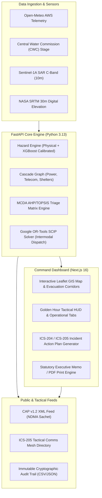

# Cascading Disaster Intelligence & Spatial Risk Platform
### State Emergency Operations Centre (SEOC) & National Disaster Management Authority (NDMA)
**Operational Basin:** Barauni – Sultanganj Diara River Basin, Begusarai District, Bihar  
**Statutory Governance:** Disaster Management Act, 2005 (Sections 30 & 34) | NDMA Standard Operating Procedures (Rev. 2024)

---

## 1. Executive Overview

In flood-prone riverine ecosystems such as the Ganga–Kosi–Gandak basin, catastrophic inundations trigger rapid compounding failures: river stage surges breaches marginal embankments, submerge state highways, cut off telecommunication base transceiver stations (BTS), trip electrical substations, isolate primary health facilities, and maroon diara island settlements.

The **Cascading Disaster Intelligence & Spatial Risk Platform** is a **decision-support platform for SEOC, DDMA and NDRF tactical commanders**. It integrates physics-derived meteorological modeling, machine learning with isotonic calibration, cascading graph theory, integer linear programming (Google OR-Tools SCIP), and satellite radar calibration into a unified operational decision-support console.

---

## 2. Core Operational Modules

### Module 1: Hydrodynamic Hazard Modeling & Calibrated ML
- **Physical Inundation Engine:** Combines rainfall depth ($mm$), storm duration ($h$), and river gauge levels ($m$) with physical terrain variables (elevation, slope, river proximity).
- **Calibrated XGBoost Model:** Integrates an 8-feature physical vector with **Isotonic Probability Calibration** configured for high-sensitivity early warning (high-recall / precautionary thresholding). See Section 3 for precision trade-offs and operational limitations.
- **Physical Hydrological Thresholds:** Calibrated to Barauni Ghat Central Water Commission (CWC) benchmarks:
  - *Warning Level:* 7.00 m
  - *Danger Level:* 8.00 m
  - *High Flood Level (HFL) Overtopping:* 8.50 m to 9.80 m

### Module 2: Cascading Infrastructure Graph & Utility Disruption
- **Network Dependency Tracking:** Analyzes cascading impacts across interdependent lifelines:
  - **Roadways:** SH-89 Barauni–Sultanganj Link, NH-31 Bypass, Embankment Bund roads.
  - **Power Grid:** Barauni 33kV Substation, Begusarai Grid Feeder. Automatically triggers hospital backup generator failover.
  - **Telecommunications:** Pipra Dewas Jio 4G BTS, Sultanganj BSNL Tower. Triggers cellular blackout alerts for diara settlements.
  - **Relief Shelters:** Real-time occupancy tracking, Sphere Project standard food stock consumption rates, and potable water bowser reserves.

### Module 3: Intermodal Resource Dispatch Optimization (Google OR-Tools SCIP)
- **Mathematical Solver:** Formulates emergency dispatch as a Mixed-Integer Linear Program (MILP) solved using the **Google OR-Tools SCIP** engine.
- **Intermodal Routing Logic:**
  - **Road Ambulances (ALS):** Hard-constrained to accessible terrestrial roadways; locked out of water-severed settlements.
  - **Inflatable Rescue Boats (IRB):** Prioritized exclusively for submerged diara sandbars (Sultanganj Diara $V_2$) and breached sectors.
  - **NDRF/SDRF Search & Rescue Teams:** Amphibious deployment capable of cross-terrain navigation.
- **Operational Unserved Settlement Handling:** Emits a dynamic `unserved_settlements` block detailing unallocated communities alongside prioritized actionable next steps (requesting external IRB flotillas, pre-positioning Civil Defence on high ground, shelter-in-place surveillance).

### Module 4: Multi-Criteria Decision Analysis (MCDA) Triage Matrix
- **Analytical Framework:** Analytic Hierarchy Process (AHP) & TOPSIS Multi-Attribute Utility Theory.
- **Objective Criteria Weights ($\sum w_i = 1.00$):**
  - $w_1 = 0.35$: Hydrodynamic Hazard Severity ($h \times v$, elevation deficit)
  - $w_2 = 0.25$: Demographic Vulnerability (percentage of elderly $>60y$ and children $<10y$)
  - $w_3 = 0.25$: Lifeline Isolation (arterial road severance, telecommunication blackout)
  - $w_4 = 0.15$: Shelter Transit Friction (distance and transit impedance to high-ground relief camps)
- **Settlement Rankings:** Dynamically ranks all 5 sector settlements ($V_1$ Pipra Dewas, $V_2$ Sultanganj Diara, $V_3$ Manjhaul Lowlands, $V_4$ Mohanpur West, $V_5$ Rampur Ghat Diara) with structured decision-support recommendations (e.g., recommended evacuation modes such as `WATERCRAFT_IRB` or `RAPID_CONVOY_EVACUATION`).

### Module 5: Sentinel-1 SAR Dual-Polarization Water Masking Calibrator
- **Microwave Radar Inundation Extent:** Interactive backscatter threshold slider ($-24.0\text{ dB}$ to $-16.0\text{ dB}$, nominal $-18.5\text{ dB}$).
- **Polarimetric Analysis:** Supports single copolarization ($VV$), cross-polarization ($VH$ for rough flood surfaces), and $VV/VH$ ratio (flooded vegetation suppression).
- **Speckle Noise Filters:** Lee $3\times3$ and Gamma MAP $5\times5$ spatial filtering calculating real-time water extent area in $\text{km}^2$ over the $16.20\text{ km}^2$ monitoring footprint.

### Module 6: ICS-205 Multi-Agency Tactical Comms Mesh
- **Fail-Safe Frequency Directory:** Standardized 6-channel tactical communications directory:
  - `CH-01`: SEOC Command & Control Dispatch (154.650 MHz VHF FM, CTCSS 103.5 Hz)
  - `CH-02`: Marine Search & Rescue IRB Flotilla (156.800 MHz Marine VHF Ch 16)
  - `CH-03`: NDRF 9th Bn Tactical Ops (162.400 MHz APCO P25 Encrypted)
  - `CH-04`: SDRF Ground Ingress & Police Patrol (148.125 MHz VHF Simplex)
  - `CH-05`: PHED & Medical Relief Lifelines (151.775 MHz VHF Repeater)
  - `CH-06`: Emergency Satellite PTT (1621.500 MHz L-Band Iridium Extreme)
- **Repeater Telemetry & Health Monitoring:** Real-time ping loopback verification across IOCL Barauni Tower, Begusarai Collectorate Annex, and Diara Island Mobile Units.

### Module 7: Draft Statutory Evacuation Recommendation & Executive Memo Generator
- **Decision-Support Formulation:** Generates draft statutory recommendations under Sections 30(2) and 34 of the Disaster Management Act, 2005 for review and signature by the District Magistrate / Incident Commander.
- **Operational Indent Recommendations:** Recommends structured advisory indents for District Police (cordons and diversions), CMO (ALS triage stations), PHED (Sphere-compliant potable water bowsers), and DSO (30-day grain reserves).
- **A4 Print Engine:** Tailored CSS `@media print` rules format the live situation into a standardized Government of Bihar draft executive memo template. The output is strictly a draft decision-support document that requires human review, validation, and official signature by the District Magistrate or designated Incident Commander before carrying legal force.

### Module 8: Common Alerting Protocol (CAP v1.2) XML & Immutable Audit Trail
- **ITU-T X.1303 Compliance:** Standardized XML emergency alert format targeting geographic circular and polygon boundaries for cell broadcast and public safety integration.
- **Immutable SHA-256 Audit Ledger:** Every operational action, simulation execution, radio check, and citizen intake produces a tamper-evident audit log entry with export support to **CSV Spreadsheets** and **Signed JSON Ledgers**.

---

## 3. Limitations & Operational Model Behaviour

> [!IMPORTANT]
> **Operational Early-Warning Calibration Profile & False-Positive Trade-off:**
> The flood model is intentionally calibrated for high recall (early warning). At the current operating threshold ($\tau \approx 0.0127$) the precision on the 2024 hold-out event is approximately 14%. This means roughly 6 non-flood cells are flagged for every true flood cell. Operators must treat Critical/High cells as precautionary until confirmed by field reports or higher-confidence sources.
>
> On the verified 27 September 2024 North Bihar flood hold-out validation set, the calibrated model demonstrates:
> - **Recall:** $\approx 76.8\%$ (43 True Positives detected out of 56 ground-truth inundated cells)
> - **Precision:** $\approx 13.7\%$ (43 True Positives out of 314 total predicted positive cells)
> - **False Positives:** 271 cells
>
> **Operational Directive for Duty Incident Commanders:** This high-sensitivity profile is an intentional design choice for disaster response: the life-safety consequence of an unalerted village inundation (False Negative) vastly exceeds the logistical friction of a precautionary patrol check (False Positive). Field commanders must cross-corroborate alerts with drone reconnaissance, gauge telemetry, or local block control reports prior to initiating forced evacuations.

---

## 4. System Architecture & Data Flow



---

## 5. API Reference Manual

The backend server runs on `http://127.0.0.1:8000` and provides 11 production REST endpoints:

### Core Pipeline Endpoints

#### `POST /api/disaster/analyze`
Executes the full end-to-end cascading disaster pipeline.
- **Request Body (JSON):**
  ```json
  {
    "mode": "simulation",
    "rainfall_mm": 180.0,
    "duration_hours": 4.0,
    "water_level_m": 8.6,
    "latitude": 25.148,
    "longitude": 85.950,
    "location_name": "Barauni-Sultanganj, Begusarai, Bihar"
  }
  ```
- **Response:** Compound object containing `event` (hazard score, hazard level, ML calibrated score, `decision_threshold`, `above_threshold`, `ml_status`, `model_behaviour`), `impact` (affected roads, villages, hospitals, population), `cascade_utilities` (substations, telecom towers, shelter status), `priority_assessment`, `resource_optimization` (OR-Tools SCIP allocations), `mcda_triage`, and `sos_feed`.

#### `POST /api/mcda/triage`
Computes Multi-Criteria Decision Analysis triage rankings for all settlements.
- **Request Body (JSON):**
  ```json
  {
    "water_level_m": 8.6,
    "rainfall_mm": 180.0,
    "risk_score": 0.84,
    "affected_roads": ["R1"],
    "affected_villages": ["V1", "V2"]
  }
  ```
- **Response:** Ranked array of settlements with composite scores, sub-criteria breakdowns, priority tiers, and assigned lead agencies.

#### `GET /api/cap/feed.xml`
Returns public ITU-T X.1303 / NDMA Sachet compliant CAP v1.2 XML with `application/xml` media type.
- **Parameters:** `alert_id` (string, default: `IN-BR-BGS-SEOC-20261021`)

#### `POST /api/sar/calibrate`
Computes calibrated water extent and pixel statistics from Sentinel-1 radar backscatter.
- **Request Body (JSON):**
  ```json
  {
    "threshold_db": -18.5,
    "polarization": "VV",
    "filter_type": "LEE_3X3",
    "total_area_km2": 16.20
  }
  ```
- **Response:** Calibrated water area in $\text{km}^2$, inundation percentage, pixel counts, and Otsu bimodal separation index.

#### `GET /api/comms/directory`
Returns the tactical ICS-205 Multi-Agency Radio Frequency Directory with channel frequencies, CTCSS tones, assignments, and repeater health statuses.

#### `POST /api/comms/ping`
Triggers automated loopback telemetry and repeater network health verification.

#### Additional Endpoints
- `GET /`: Platform status, version, and active endpoint index.
- `GET /api/sensor/live`: Fetches real-time AWS meteorological observations and derived parameters for arbitrary coordinates.
- `GET /api/disaster/spatial-grid`: Generates a multi-modal 2D spatial raster grid for GIS visualization.
- `GET /api/historical/bihar-2024`: Multi-temporal snapshots for the verified 27 September 2024 Bihar flood event.
- `POST /api/ml/experimental`: Runs inference on the physical XGBoost model with calibrated confidence diagnostics.

---

## 6. Repository Structure

```text
.
├── backend/
│   ├── .venv/                          # Python virtual environment
│   ├── tests/                          # Automated Pytest test suite
│   │   ├── conftest.py                 # FastAPI TestClient fixture
│   │   ├── test_api_endpoints.py       # REST API integration tests
│   │   ├── test_cascade_engine.py      # Infrastructure cascade failure tests
│   │   ├── test_hazard_engine.py       # Hydrological hazard & ML tests
│   │   ├── test_mcda_engine.py         # AHP/TOPSIS triage matrix tests
│   │   └── test_resource_optimizer.py  # OR-Tools SCIP intermodal dispatch tests
│   ├── cascade_engine.py               # Dependency graph for power, telecom, and hospitals
│   ├── disaster_pipeline.py            # Master orchestration pipeline
│   ├── grid_engine.py                  # Spatial raster grid generator
│   ├── hazard_engine.py                # Hydrological scoring formulation
│   ├── historical_engine.py            # Bihar 2024 flood timeline data
│   ├── live_sensor.py                  # Open-Meteo AWS telemetry client
│   ├── main.py                         # FastAPI application & route definitions
│   ├── mcda_engine.py                  # AHP/TOPSIS Multi-Criteria Decision Analysis engine
│   ├── predict_physical_calibrated.py  # Calibrated XGBoost inference engine
│   ├── priority_engine.py              # Settlement vulnerability scoring
│   ├── resource_optimizer.py           # Google OR-Tools SCIP linear solver
│   └── requirements.txt                # Python package dependencies
├── frontend/
│   ├── app/
│   │   ├── globals.css                 # Dark institutional theme & @media print styles
│   │   ├── layout.tsx                  # Root Next.js layout
│   │   ├── page.tsx                    # Command Center dashboard & operational modules
│   │   ├── privacy/page.tsx            # Official Privacy Policy
│   │   └── terms/page.tsx              # Statutory Terms & Governance Disclaimer
│   ├── components/
│   │   └── DisasterMap.tsx             # Interactive Leaflet GIS map with evacuation corridors
│   ├── data/
│   │   └── spatialGrid.ts              # Geospatial coordinates, corridors, and baseline snapshots
│   ├── package.json                    # Next.js and npm dependencies
│   └── tsconfig.json                   # TypeScript configuration
└── README.md                           # Master platform documentation
```

---

## 7. Verification & Quality Assurance

### Automated Pytest Suite
The backend is covered by an automated test suite executed via `pytest`:
```bash
cd backend
.\.venv\Scripts\python.exe -m pytest tests/
```
**Test Results:**
```text
======================= 17 passed, 5 warnings in 0.24s =======================
- tests/test_api_endpoints.py ......     [6/6 passed]
- tests/test_cascade_engine.py ...       [3/3 passed]
- tests/test_hazard_engine.py ....       [4/4 passed]
- tests/test_mcda_engine.py ..           [2/2 passed]
- tests/test_resource_optimizer.py ..    [2/2 passed]
```

### Next.js Production Build
The frontend compiles with zero TypeScript errors or warnings:
```bash
cd frontend
npm run build
```
**Build Output:**
```text
✓ Compiled successfully in 1591ms
  Running TypeScript ... Finished TypeScript in 6.9s
✓ Generating static pages using 7 workers (6/6) in 1931ms
Route (app): / , /_not-found , /privacy , /terms (All prerendered statically)
```

---

## Limitations & Assumptions

This platform is engineered to support emergency decision-makers during rapid-onset flood scenarios. Operational personnel, incident commanders, and system integrators must review the following limitations, design trade-offs, and baseline assumptions:

1. **High-Recall Model Calibration & Early Warning Trade-Off:**
   - The flood prediction model is intentionally calibrated for high recall (early warning) rather than high precision.
   - At the current operating threshold ($\tau \approx 0.012658$), the precision on the 2024 hold-out validation event is approximately 14% (with $\approx 76.8\%$ recall and 271 false positives out of 314 predicted positive cells).
   - This design prioritizes life safety to ensure no rapidly flooding settlement is missed; however, it means approximately 6 non-flooded cells may be flagged for every true flood cell. Operators and incident commanders must treat Critical and High risk alerts as precautionary early warnings until verified by drone reconnaissance, local field patrols, or gauge telemetry.

2. **Spatial Raster Grid Resolution:**
   - The current SAR risk raster displayed on the map is an $8 \times 8$ grid across the $16.20\text{ km}^2$ monitoring footprint (approximately $500\text{ m} \times 500\text{ m}$ per cell).
   - While effective for macro-level sector screening and district-level resource dispatch, this resolution is relatively coarse and does not capture micro-topographic variations, individual drainage channels, or single-structure elevations. Finer-resolution modeling ($10\text{ m}$ pixel scale) is planned for future iterations.

3. **Sensor Telemetry Feeds and Data Freshness:**
   - Certain real-time data inputs (specific river gauge telemetry, automatic weather stations, and Sentinel-1 SAR orbital passes) are subject to satellite revisit intervals (6 to 12 days for Sentinel-1) or communication latencies during severe cyclonic/monsoonal events.
   - When real-time upstream feeds are delayed, unavailable, or running in simulated exercise mode, synthetic or baseline hydrological models are utilized. Operators must always verify the persistent **Data Freshness** indicator (`generated_at` timestamp and age indicator) displayed in the application header and API payloads before finalizing operational plans.

4. **Decision-Support Scope & Statutory DM Act Authority:**
   - The platform is strictly an automated decision-support system and does not possess legal or operational authority to issue binding directives.
   - All generated evacuation plans, incident action plans (IAP), and executive memos constitute draft recommendations under Sections 30(2) and 34 of the Disaster Management Act, 2005.
   - Final authority and legal responsibility for ordering evacuations, deploying emergency personnel, requisitioning equipment, declaring containment zones, and issuing public advisories remain exclusively with the District Magistrate, District Disaster Management Authority (DDMA), and designated Incident Commanders.

5. **Operational Validation & Pilot Status:**
   - The platform algorithms, mathematical solver constraints (OR-Tools SCIP), and cascading logic have been verified against historical data (including the September 2024 Bihar flood event) and simulated test benches.
   - The system has not yet undergone validation in a full multi-agency live field exercise with active participation from NDRF, SDRF, DDMA, and the State Emergency Operations Centre (SEOC). Live multi-agency tabletop simulations and field pilot testing with district disaster management authorities represent the next operational milestone.

---

## 8. Local Setup & Deployment Guide

### Prerequisites
- **Python:** 3.11+ (Python 3.13 recommended)
- **Node.js:** v18.0+ or v20.0+ with npm
- **Operating System:** Windows, Linux, or macOS

### Step 1: Clone & Navigate
```bash
git clone <repository-url>
cd cascading-disaster-intelligence-platform-main
```

### Step 2: Set Up Backend
```bash
cd backend
python -m venv .venv

# Windows
.\.venv\Scripts\activate
# Linux/macOS
source .venv/bin/activate

pip install -r requirements.txt
pip install pytest httpx
```

### Step 3: Run Backend Server
```bash
uvicorn main:app --port 8000 --host 127.0.0.1 --reload
```
- Core API: `http://127.0.0.1:8000`
- Swagger Documentation: `http://127.0.0.1:8000/docs`

### Step 4: Set Up & Run Frontend
In a separate terminal:
```bash
cd frontend
npm install
npm run dev
```
- Command Dashboard: `http://localhost:3000`
- Privacy Policy: `http://localhost:3000/privacy`
- Statutory Terms: `http://localhost:3000/terms`

---

## 9. Standards, Governance & Institutional Compliance

1. **Disaster Management Act, 2005 (Act No. 53 of 2005):** Generates draft statutory recommendations under Sections 30(2) and 34 of the Disaster Management Act, 2005 for review and signature by the District Magistrate / Incident Commander. The platform operates exclusively as decision support; statutory authority and binding legal execution remain solely with the designated administrative authorities.
2. **ITU-T Recommendation X.1303 / OASIS CAP v1.2:** Common Alerting Protocol emergency bulletins conform to national interoperability standards for the NDMA Sachet system.
3. **Sphere Humanitarian Standards:** Relief supply allocations (water minimum 15 L/person/day, food rations 2,100 kcal/day, chlorine water purification, and shelter floor space) adhere to the Sphere Project Minimum Standards in Disaster Response.
4. **Zero-Emoji Institutional Aesthetic:** The user interface adheres strictly to Government of India and Bihar State Disaster Management Authority visual standards using a slate-dark operational palette (`#0b0f17`, `#0f141f`, `#1e2638`).
